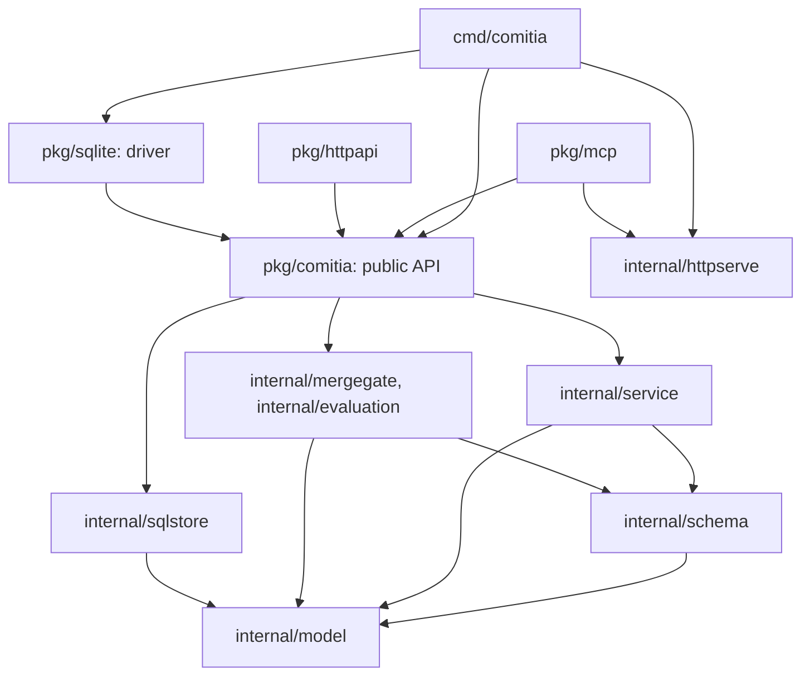

# Comitia architecture

## Status

This document separates the current v1 contract from the intended architecture; target properties are not claims about implemented behavior. The README and command reference describe only what the current tree does.

## Purpose

Comitia coordinates work among external agents. A workspace groups several work contexts, and each context can refer to an issue, pull request, document, URL, or another resource. Comitia stores coordination state; it does not execute agents and it does not synchronize a local checkout with a remote system.

The application is library-first. One Go application API owns the domain rules and is shared by transport adapters; arrows are imports:

Adapters translate input, authentication material, and errors. They must not duplicate authorization, task leasing, message delivery, or revocation rules. Storage implementations provide persistence and transactions without becoming a second application layer.

## Deployment modes

The same binary is intended to support three deployment shapes:

| Mode | Topology | Trust boundary |
|---|---|---|
| Embedded | Library and SQLite database live in the caller's process and filesystem | The host process and users able to alter its files are trusted |
| Local daemon | Local clients connect to a long-running process | The daemon authenticates requests and mediates database access |
| Shared server | Remote clients connect through a network adapter | Target: the server authenticates requests, authorizes operations, and isolates tenants/workspaces |

These shapes share the application API and data model. Transport-specific concerns, such as HTTP request limits or local socket permissions, stay in their adapters.

## Core model

### Identity and authority

- A **principal** is the durable identity to which workspace membership and base permissions are assigned.
- A **session** is an authenticated, time-bounded interaction acting for a principal.
- A **context grant** authorizes a session or child delegate to act within a work context. Its scope and expiry can only narrow the authority from which it was derived.

The current v1 API has a global administrative owner and session-level context grants. It does not expose separate principal-to-workspace membership. Within that model, possession of a context identifier conveys no authority. `ReadStore.Grants(sessionID, contextID, now)` returns only that session's own effective grants: every grant in its parent-grant chain and every owner and issuer session must exist, be unrevoked, and expire strictly after the sampled time. Missing ancestry and cycles exclude the grant; unexpected storage failures return errors and take precedence when lookups fail together. Permissions are checked on one effective grant at a time. Parent-readable access is a separate read-only service rule and never a delegation source. External stores can reuse `GrantEvaluator` for this ancestry policy and run `storetest.Grants(t, open)` for grant, archival and transaction conformance, including durable grant/session descendant revocation and rollback; that suite does not cover messages, tasks or presence.

The target shared-server model adds explicit workspace membership for principals. A child delegation must be no broader and must expire no later than its parent. Revoking a parent session invalidates its descendants, including descendants that have not yet expired. Implementations should make this ancestry explicit so authorization can evaluate cascading revocation consistently.

Authentication proves that a caller controls an accepted credential. It does not prove that the principal is a human, that an agent follows instructions, that reported work occurred, or that referenced external resources are trustworthy. Authorization is evaluated separately for every protected operation.

### Workspaces and contexts

A workspace is the administrative and authorization boundary for related work. It contains multiple contexts. A context records coordination around a resource reference; the referenced object remains owned by its external system. Comitia should treat references as identifiers and metadata, not as a promise to fetch or synchronize their content.

Contexts form a tree. A child context records its parent context, optionally the parent task it serves, and its creator; these never change after creation. Sessions holding `create` on a context can create children, whose creator grant derives from the creator's parent grant. Children are private by default: parent members can list their metadata but not read their contents, unless the child is created `parent_readable`. Nothing relays automatically between parent and child; coordinators that belong to both post summaries on purpose. `ContextArchivedAt` uses the same creator-grant ancestry policy, retaining the earliest expiry or revocation time at or before the sampled time, or an earlier explicit archive time. Cyclic or missing creator ancestry returns an error. An independent grant can still permit reading an archived context; mutation checks reject archived contexts.

### Messages

Messages are durable and ordered using storage-backed identifiers or cursors. Consumers poll and replay from a known position, then acknowledge processing. The adapters provide bounded long polling (`wait_messages`, default 30 seconds,
capped at 60) and cursor-based replay, without SSE or server push. Delivery can be repeated, so consumers must supply or retain a deduplication key and handlers must be idempotent.

An acknowledgement records a durable, per-session cursor; a missing acknowledgement reads as cursor zero. It must not erase the durable event required by other consumers. Retention and compaction policies must preserve the documented replay window. Ordering guarantees must be stated per stream rather than inferred across unrelated contexts.

### Tasks

Tasks use leased ownership. Acquiring a task creates an ownership lease with an expiry. Only the current lease holder may perform owner-only transitions. A worker renews a lease while active and completes or releases it with the lease identity it acquired. Optional session-scoped operation IDs on create/claim/renew persist conflict-checked non-secret task receipts atomically with the mutation. An authorized retry after restart rotates to a fresh token only for a still-current live lease, preserving version and expiry and fencing previous tokens; moved-on receipts conflict. Raw claim tokens are never persisted in SQLite or copied into backups. The optional `TaskMutationAPI` and `TaskReceiptReadStore`/`TaskReceiptWriteStore` capabilities preserve existing task/store method sets; custom stores that support receipts implement `TaskReceipt`/`PutTaskReceipt` and persist only non-secret task outcomes. Receipts omit the task title and body, which retries re-read from the task; full receipts from older binaries remain valid. Supplying an operation ID to an unsupported API/store returns `ErrInvalid`; ordinary calls retain their behavior. Optional message task fences validate the live holder/token/version in the append transaction and retain authenticated attempt provenance; unfenced observer messages remain valid.

After expiry, another worker may recover the task. Late completion from the old owner must not overwrite the recovered owner's state. Storage transactions fence updates with the current lease identity. The initial completion operation records completed status but has no result payload.

## Application boundaries

The package `github.com/krimvp/comitia/pkg/comitia` is the public API and nothing else: type aliases, forwarding functions, exported limits and the build stamp (`Version`, `Revision`, `Dirty`). Its `API` interface is the authoritative method inventory.

The implementation lives in internal packages, each importing only those listed:

| Package | Owns | May import |
|---|---|---|
| `internal/model` | Data types, errors, permissions, `API` and `Store` interfaces, shared rules | none |
| `internal/schema` | Built-in message schema registry, payload types, validators | `model` |
| `internal/sqlstore` | The SQLite `Store`: queries, migrations, backfills | `model` |
| `internal/service` | `*Service`: authentication, authorization, grants, delivery, leases, presence | `model`, `schema` |
| `internal/mergegate` | Merge certificate verification | `model`, `schema` |
| `internal/evaluation` | Evaluation reports | `model`, `schema` |
| `internal/httpserve` | Request logging and serve loop for `cmd/comitia` and `pkg/mcp` | none |

The packages other modules import live under `pkg/`, the command under `cmd/comitia`. No internal package imports `pkg/comitia`. The adapters `cmd/comitia`, `pkg/mcp` and `pkg/httpapi` reach the implementation only through `pkg/comitia` and `pkg/sqlite`, except for `internal/httpserve`. Package `pkg/sqlite` links the driver and opens embedded stores (`sqlite.OpenSQLite`), so remote clients of `pkg/comitia`, `pkg/httpapi` and `pkg/mcp` never link it; the deprecated `comitia.OpenSQLite` needs a registered driver. Package `pkg/storetest` checks external `Store` implementations.

Tests in `pkg/comitia`, not this text, are the source of truth: `TestPublicAPISurface` compares the exported API of every public package with `testdata/api_surface.golden`; `TestInternalLayering` and `TestAdapterImports` (`layering_test.go`) enforce the table and the adapter rule, and `TestRepositoryRootHasNoGoFiles` keeps Go code out of the repository root; `import_boundary_test.go` keeps the driver out of `pkg/comitia`, `pkg/httpapi` and `pkg/mcp`.

`pkg/comitia` aliases the types of `internal/model`, so their exported methods and fields are public API. Nothing in `internal/model` may gain an exported method or field unless it is meant to become public API; a helper another internal package needs is an exported free function instead.

`Bootstrap` is a one-time, local operation and must not be exposed through the HTTP adapter. Adapters map the stable errors into their own status or exit conventions without exposing SQLite errors as public contracts. The [code map](code-map.md) shows where each domain lives and follows a request through the code.

## Consistency and recovery

Operations that change authority, lease ownership, deduplication state, or acknowledgement cursors require transactional persistence. Every `View` supplies one consistent snapshot; `Update` serializes writes, reads its own writes, commits only on a nil callback error, and rolls back on errors or panics. Callback stores live only within the callback, and cancellation covers admission and database operations. SQLite is the initial persistence engine. File databases use WAL with up to four query-only reader connections and one serialized writer; reader and writer admission honor cancellation. Each authorized read operation keeps a single transaction snapshot, including an empty message scan and its high-water mark. In-memory databases keep a single connection because they cannot use WAL. Schema generations and backfills commit atomically. Backfills carry their own generations, so DDL edits never rescan history; a backfill reruns only when its generation is new or an object it fills, or a trigger keeping that current, was missing. Routine opens probe schema metadata and indexed repair queues without a write lock or historical message scans. Insert triggers queue rows written by older binaries for incremental dedupe-scope and child-creator repair on the next open; current writes clear their own queue entries in the same transaction. Missing schema objects trigger repair, and conflicting dedupe scopes fail migration rather than silently discarding rows. Grant/session ancestry facts are memoized only within each transaction and discarded after mutations; effective access is evaluated at the supplied time, with no cache across requests. Context listing authenticates and samples time once, retains effective access checks for each row, and uses the optional `BatchContextReadStore` capability to batch grants and archive metadata. Stores without that capability use individual reads with the same policy.

The process may stop between committing state and returning a response. Callers should use operation or deduplication identifiers for retried writes. Recovery code should derive truth from durable state, especially grant ancestry, lease expiry, and acknowledgement cursors.

## Out of scope

The architecture does not include running or supervising agent processes, managing their sandboxes, cloning repositories, mirroring issues or pull requests, handling GitHub or GitLab webhooks, or synchronizing local and remote files. References are generic metadata. Those systems can integrate through external workers while Comitia remains the coordination authority.
