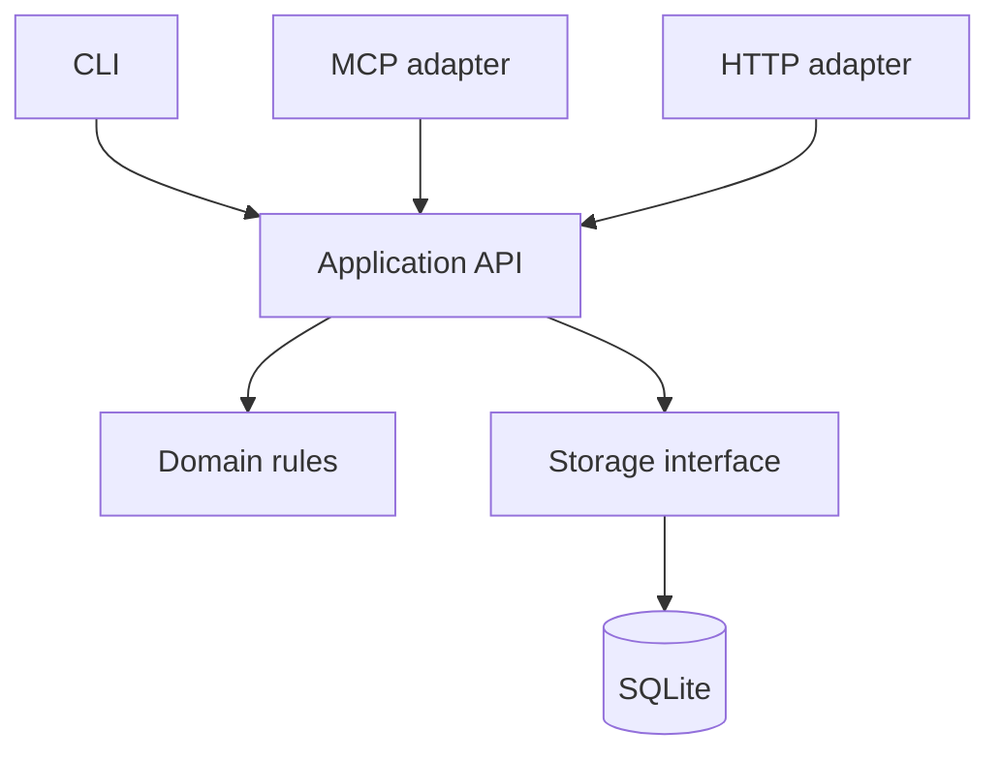

# Comitia architecture

## Status

This document distinguishes the current v1 application contract from the intended architecture. Target properties are not claims about implemented behavior. The README and command reference describe only behavior verified in the current tree.

## Purpose

Comitia coordinates work among external agents. A workspace groups several work contexts, and each context can refer to an issue, pull request, document, URL, or another resource. Comitia stores coordination state; it does not execute agents and it does not synchronize a local checkout with a remote system.

The application is library-first. One Go application API owns the domain rules and is shared by transport adapters:

Adapters translate input, authentication material, and errors. They must not duplicate authorization, task leasing, message delivery, or revocation rules. Storage implementations provide persistence and transactions without becoming a second application layer.

## Deployment modes

The same binary is intended to support three deployment shapes:

| Mode | Topology | Trust boundary |
|---|---|---|
| Embedded | Library and SQLite database live in the caller's process and filesystem | The host process and users able to alter its files are trusted |
| Local daemon | Local clients connect to a long-running process | The daemon authenticates requests and mediates database access |
| Shared server | Remote clients connect through a network adapter | Target: the server authenticates requests, authorizes operations, and isolates tenants/workspaces |

These shapes share the application API and data model. Transport-specific concerns, such as HTTP request limits or local socket permissions, stay in their adapters.

## Core model

### Identity and authority

- A **principal** is the durable identity to which workspace membership and base permissions are assigned.
- A **session** is an authenticated, time-bounded interaction acting for a principal.
- A **context grant** authorizes a session or child delegate to act within a work context. Its scope and expiry can only narrow the authority from which it was derived.

The current v1 API has a global administrative owner and session-level context grants. It does not expose separate principal-to-workspace membership. Within that model, possession of a context identifier conveys no authority.

The target shared-server model adds explicit workspace membership for principals. A child delegation must be no broader and must expire no later than its parent. Revoking a parent session invalidates its descendants, including descendants that have not yet expired. Implementations should make this ancestry explicit so authorization can evaluate cascading revocation consistently.

Authentication proves that a caller controls an accepted credential. It does not prove that the principal is a human, that an agent follows instructions, that reported work occurred, or that referenced external resources are trustworthy. Authorization is evaluated separately for every protected operation.

### Workspaces and contexts

A workspace is the administrative and authorization boundary for related work. It contains multiple contexts. A context records coordination around a resource reference; the referenced object remains owned by its external system. Comitia should treat references as identifiers and metadata, not as a promise to fetch or synchronize their content.

Contexts form a tree. A child context records its parent context, optionally the parent task it serves, and its creator; these never change after creation. Sessions holding `create` on a context can create children, whose creator grant derives from the creator's parent grant. Children are private by default: parent members can list their metadata but not read their contents, unless the child is created `parent_readable`. Nothing relays automatically between parent and child; coordinators that belong to both post summaries on purpose.

### Messages

Messages are durable and ordered using storage-backed identifiers or cursors. Consumers poll and replay from a known position, then acknowledge processing. The adapters provide bounded long polling (`wait_messages`, default 30 seconds,
capped at 60) and cursor-based replay, without SSE or server push. Delivery can be repeated, so consumers must supply or retain a deduplication key and handlers must be idempotent.

An acknowledgement records a durable, per-session cursor; a missing acknowledgement reads as cursor zero. It must not erase the durable event required by other consumers. Retention and compaction policies must preserve the documented replay window. Ordering guarantees must be stated per stream rather than inferred across unrelated contexts.

### Tasks

Tasks use leased ownership. Acquiring a task creates an ownership lease with an expiry. Only the current lease holder may perform owner-only transitions. A worker renews a lease while active and completes or releases it with the lease identity it acquired.

After expiry, another worker may recover the task. Late completion from the old owner must not overwrite the recovered owner's state. Storage transactions fence updates with the current lease identity. The initial completion operation records completed status but has no result payload.

## Application boundaries

The application layer exposes use cases rather than transport-shaped handlers through the `github.com/krimvp/comitia` package. Its `API` interface currently groups:

- workspace and membership management;
- context creation and resource references;
- session and delegated grant lifecycle;
- durable message append, replay, acknowledgement, and deduplication;
- task creation, lease acquisition, renewal, completion, release, and recovery.

The package's `API` interface is the authoritative method inventory. `Bootstrap` is a one-time, local operation and must not be exposed through the HTTP adapter. Adapters should map the package's stable errors into their own status or exit conventions without exposing SQLite errors as public contracts.

## Consistency and recovery

Operations that change authority, lease ownership, deduplication state, or acknowledgement cursors require transactional persistence. SQLite is the initial persistence engine. File databases use WAL with up to four query-only reader connections and one serialized writer; reader and writer admission honor cancellation. Each authorized read operation keeps a single transaction snapshot, including an empty message scan and its high-water mark. In-memory databases keep a single connection because they cannot use WAL. Schema generations and backfills commit atomically. Routine opens probe schema metadata and indexed repair queues without a write lock or historical message scans. Insert triggers queue rows written by older binaries for incremental dedupe-scope and child-creator repair on the next open; current writes clear their own queue entries in the same transaction. Missing schema objects trigger repair, and conflicting dedupe scopes fail migration rather than silently discarding rows.

The process may stop between committing state and returning a response. Callers should use operation or deduplication identifiers for retried writes. Recovery code should derive truth from durable state, especially grant ancestry, lease expiry, and acknowledgement cursors.

## Out of scope

The architecture does not include running or supervising agent processes, managing their sandboxes, cloning repositories, mirroring issues or pull requests, handling GitHub or GitLab webhooks, or synchronizing local and remote files. References are generic metadata. Those systems can integrate through external workers while Comitia remains the coordination authority.
